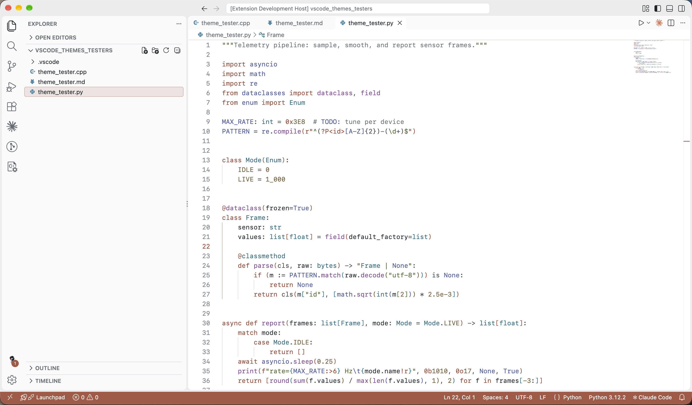
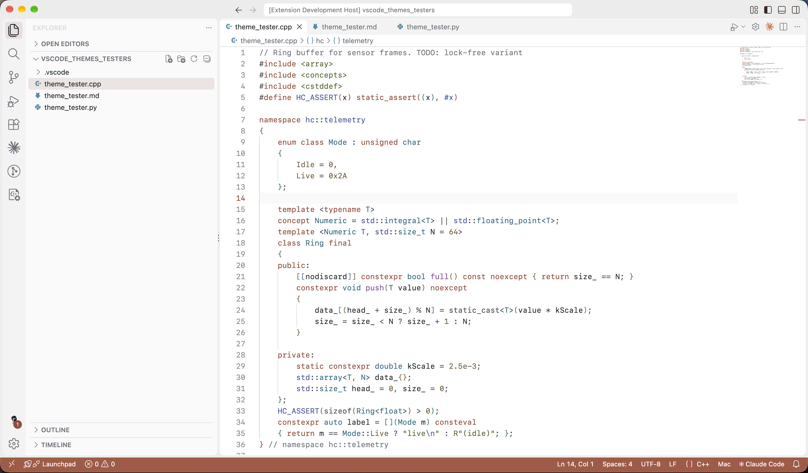
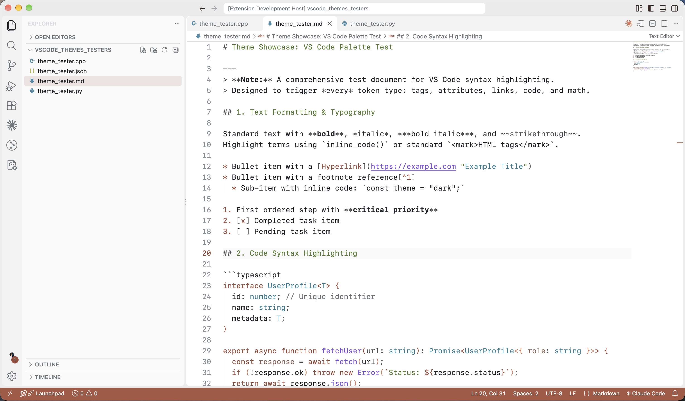
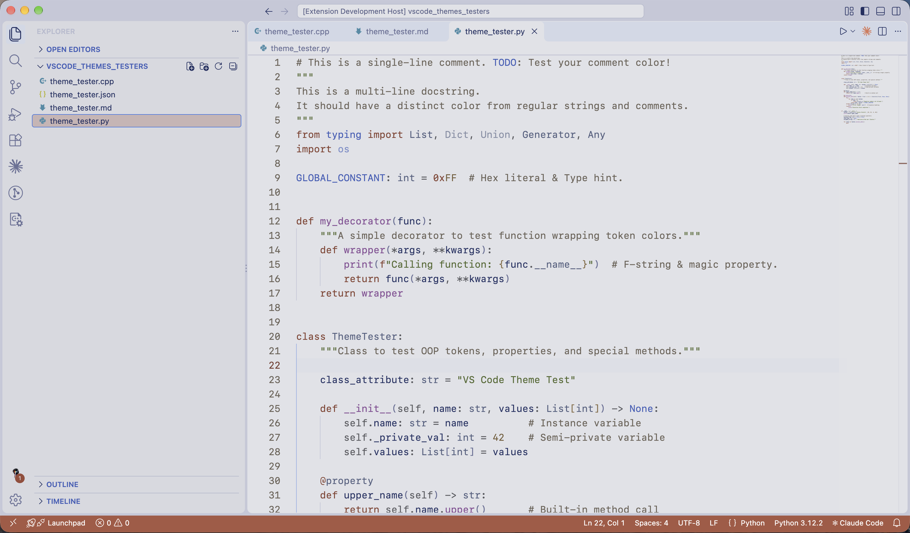
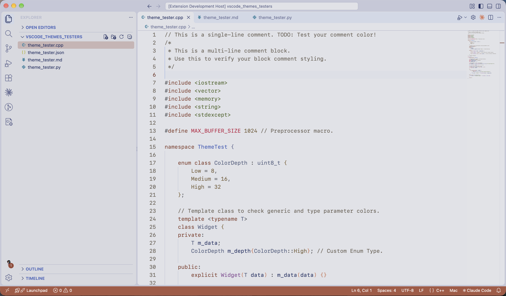
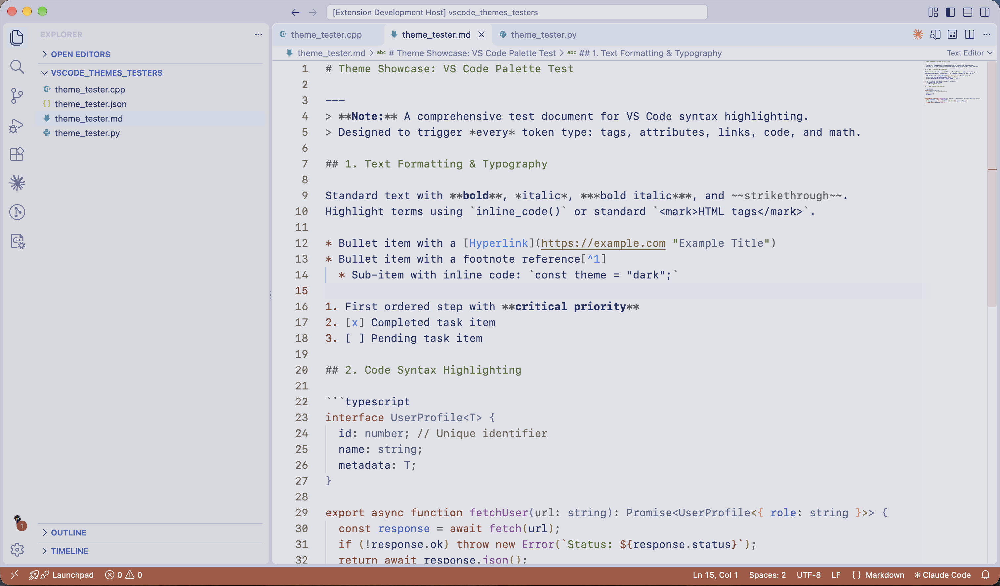
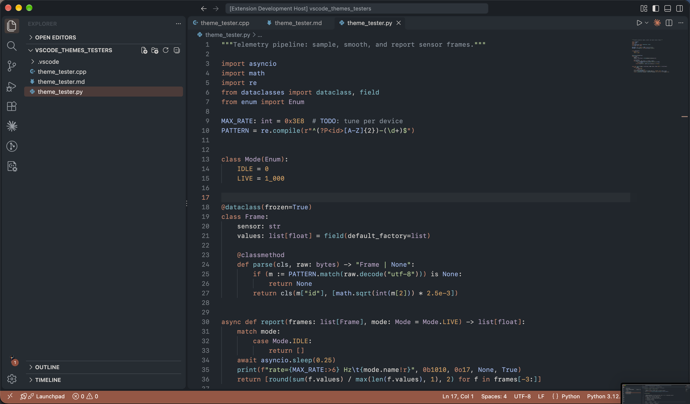
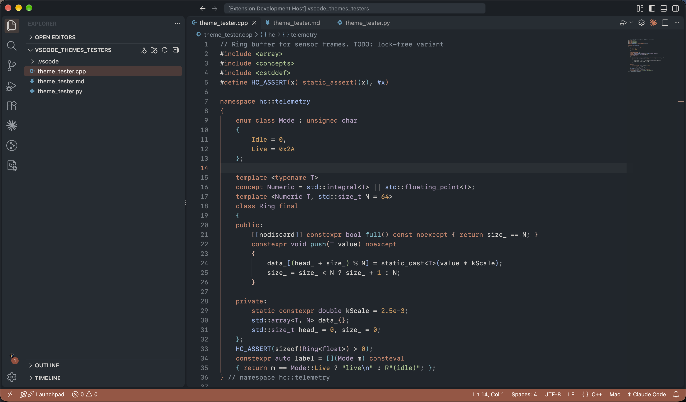
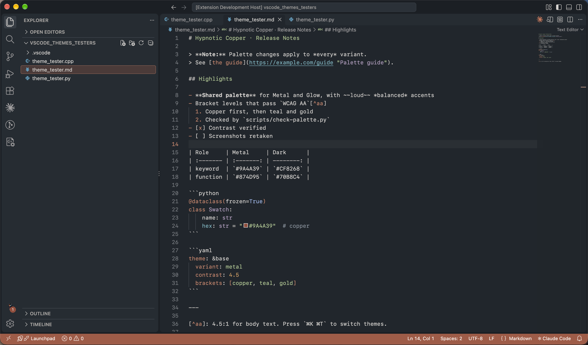

# Hypnotic Copper

**Hypnotic Copper** is a family of carefully crafted Visual Studio Code themes with Metal, Glow, and Dark variants shaped by readable contrast and warm copper accents.

Rather than relying on highly saturated rainbow syntax highlighting, Hypnotic Copper emphasizes readability through restrained color usage, semantic highlighting, and a cohesive palette. The result is a calm editing experience designed for long coding sessions.

## Why Hypnotic Copper?

Hypnotic Copper started as an attempt to make copper accents feel useful rather than decorative. The themes share the same basic vocabulary across three surfaces: blue-gray metal, crisp white, and graphite dark. Metal keeps a cool machined feel, Glow keeps the editor and terminal bright, and Dark keeps the contrast comfortable in lower light.

The goal is modest: keep the workspace calm, make syntax and semantic colors easy to scan, and let terminal tools preserve their own signal colors. Copper is used as an accent for focus, selection, and identity rather than as a blanket tint.

It is still a theme in motion, learning its own balance as the three variants settle into their roles. That is part of the point: each release tries to make the palette a little clearer, calmer, and more useful.

## Themes

### Hypnotic Copper Metal

A cool metallic theme inspired by machined aluminum and softly tinted blue-gray interfaces.

* Soft blue-gray editor and workbench surfaces
* Deep navy primary text with clear secondary foregrounds
* Warm copper accents for keywords, active UI elements, and modified resources
* Copper-accented list, input, scrollbar, and status-bar interactions
* Blue focus and information colors that remain distinct from copper emphasis
* WCAG AA-contrast syntax highlighting, with comment, punctuation, type, and function colors tuned to stay clearly distinct from one another as well as from the background
* The same syntax palette as Glow, so the two light variants differ only in surface
* Designed for bright environments without the harshness of traditional light themes

### Hypnotic Copper Glow

A crisp white light theme with the contrast language of Hypnotic Copper Dark.

* White editor and terminal surfaces
* Off-white workbench structure inside a soft gray window frame
* Copper accents from the burnished copper ladder, led by `#9A4A39`
* The same syntax palette as Metal, with evenly weighted accents so no single color dominates
* Selectively darkened foregrounds for light-background readability
* Targeted Python and C++ token refinements
* Palette-tuned terminal ANSI colors with distinct command-line signals

### Hypnotic Copper Dark

A charcoal and graphite variant that preserves the same visual identity.

* Deep graphite editor and workbench
* Warm copper highlights throughout the interface
* Palette-tuned terminal ANSI colors for build tools and shell output
* Carefully balanced syntax colors for excellent readability
* Comfortable for extended coding sessions

## Design Philosophy

Hypnotic Copper follows a few simple principles:

* Readability comes before decoration.
* Color should communicate meaning rather than compete for attention.
* Copper is reserved for emphasis instead of being used everywhere.
* Comments remain subtle.
* No italics.
* No forced bold styling for programming-language syntax.
* Semantic highlighting is used where supported to provide richer information without increasing visual noise.
* UI elements should feel cohesive rather than visually fragmented.

The syntax palette intentionally remains restrained:

* **Copper** — keywords, decorators, string prefixes, Bazel keyword arguments, HTML tags
* **Callable accent** — functions, methods, and Bazel rule names: cyan in Dark, plum in Metal and Glow
* **Sage** — strings and regular expressions: sage in Dark, olive in Metal and Glow
* **Type color** — types, classes, interfaces, enums, type parameters, and primitive types: plum in Dark, teal in Metal and Glow
* **Steel** — namespaces, constants, readonly symbols, macros, and built-in constants such as `None` and `True`: periwinkle in Dark, steel blue in Metal and Glow
* **Bronze** — numbers and enum members
* **Graphite** — punctuation, operators, labels, and `self`/`cls`
* **Silver** — variables and parameters
* **Gray** — comments: cool gray in Dark and Glow, sage gray in Metal

Metal and Glow use identical hex values for every syntax role. Warnings and errors use their own amber and crimson (rose in Dark), so they never match a syntax color. Deprecated symbols are shown with a strikethrough, and each token keeps the same color before and after semantic highlighting loads.

## Features

* ✓ Metal, Glow, and Dark variants
* ✓ Semantic highlighting with matching TextMate colors, so tokens keep their color when a language server loads
* ✓ WCAG AA contrast for every syntax color and bracket level in all three variants
* ✓ Syntax roles kept visibly apart from one another, measured by perceptual color difference
* ✓ Carefully tuned workbench colors
* ✓ Broad coverage for Chat, inline editing, diff and merge views, notebooks, testing, settings, and SCM graphs
* ✓ Refined GitLens integration
* ✓ Improved hover widgets
* ✓ Six-level bracket pair colors that lead with copper and alternate hues, so adjacent levels never look alike
* ✓ Designed for the VS Code modern UI: a unified neutral window frame, borderless floating cards, and a calm unfocused state
* ✓ A single burnished copper ladder shared by every copper accent
* ✓ Copper-aware status bar, remote indicator, and compact-item hover states
* ✓ Bright yellow debugging status bar that stays distinct from copper and warnings
* ✓ Palette-tuned terminal ANSI styling with distinct warning and error colors
* ✓ Consistent theme color keys across variants
* ✓ Targeted Python, C++, Go, Starlark, Bazel, YAML, and Markdown token refinements
* ✓ Dark terminal and editor tooltips
* ✓ Consistent Source Control and Activity Bar styling
* ✓ No italics
* ✓ No forced bold styling for programming-language syntax

## Compatibility

Hypnotic Copper requires Visual Studio Code 1.125.0 or newer. The modern UI window frame colors take effect in Visual Studio Code 1.141 and newer; earlier versions ignore them.

## Installation

1. Open the **Extensions** view in Visual Studio Code.
2. Search for **Hypnotic Copper**.
3. Install the extension.
4. Open **Preferences → Color Theme**.
5. Choose one of the following:

   * **Hypnotic Copper Metal**
   * **Hypnotic Copper Glow**
   * **Hypnotic Copper Dark**

## Screenshots

Each variant is shown with Python, C++, and Markdown examples.

### Hypnotic Copper Glow

**Python**

**C++**

**Markdown**

### Hypnotic Copper Metal

**Python**

**C++**

**Markdown**

### Hypnotic Copper Dark

**Python**

**C++**

**Markdown**

## Feedback

Suggestions, bug reports, and pull requests are welcome.

If you find inconsistencies between languages, semantic highlighting, or editor UI elements, please open an issue. Hypnotic Copper is continuously refined with readability as the primary goal.

## License

MIT
